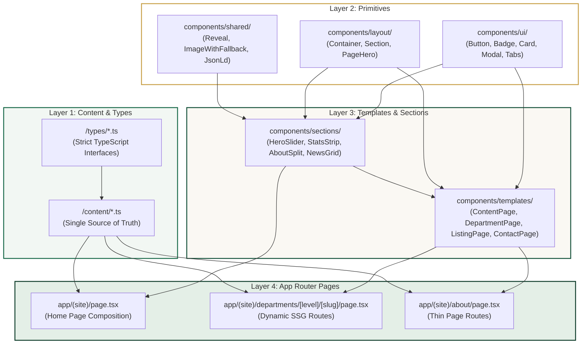

# MGMCET Architecture Guide

This document describes the design philosophy, component layers, data pipelines, and engineering conventions governing the **MGM College of Engineering and Technology (MGMCET)** website.

---

## 1. Core Architecture Philosophy

The MGMCET platform follows strict architectural boundaries to guarantee maintainability, high performance, and rapid re-skinning:

1. **Content as Code:** All editorial copy, statistics, navigation links, and program details reside exclusively in `/content/*.ts` as strongly-typed data structures. No strings or numbers are hardcoded in React components.
2. **Component Purity:** UI components receive typed props and render semantic, accessible HTML. Pages are thin composition wrappers (`app/`) that import data from `/content` and pass it to reusable templates (`components/templates/`) or standalone sections (`components/sections/`).
3. **Static Generation (`output: "export"`):** Every page is prerendered to static HTML at build time using Next.js App Router and `generateStaticParams`. There are zero server-side node runtimes, edge functions, or dynamic server dependencies.
4. **Token-Driven Design System:** Styling strictly leverages semantic tokens defined in `app/globals.css` under Tailwind CSS v4's `@theme` directive. The platform can be completely re-skinned for another institution by updating CSS tokens alone.

---

## 2. The 4-Layer Architecture

---

### Layer 1: Content & Types (`types/` & `content/`)
- **`types/`**: Defines strict TypeScript interfaces for every data model (`DepartmentDetail`, `NewsItem`, `FacultyMember`, `SiteConfig`, etc.). No `any` types are permitted.
- **`content/`**: Houses all structured data:
  - `site.ts`: Global institutional metadata, contact numbers, email addresses, and social handles.
  - `navigation.ts`: Header mega menu items, mobile drawer tree, and footer columns.
  - `departments/`: 15 department files categorized under `btech/`, `mtech/`, and `polytechnic/`, exported via a central registry in `index.ts`.
  - `home.ts`: Carousel slides, "Why MGM" features, director quote, and stats strip.
  - `news.ts`, `academics.ts`, `admissions.ts`, `campus-life.ts`, `placements.ts`, `faculty.ts`, `downloads.ts`, `gallery.ts`.

### Layer 2: Primitives (`components/ui/`, `components/layout/`, `components/shared/`)
- **`components/ui/`**: Atomic, accessible interface components built with `class-variance-authority` (CVA) and `cn()`:
  - `Button`, `Badge`, `Card`, `Input`, `Textarea`, `Select`, `Tabs`, `Accordion`, `Modal`, `Tooltip`, `Breadcrumb`, `Pagination`, `Skeleton`, `Divider`, `IconBox`, `Avatar`, `SmartLink`.
- **`components/layout/`**: Structural layout containers enforcing consistent spacing and max-widths:
  - `Container`: Responsive max-width wrappers (`sm`, `md`, `lg`, `default`, `full`).
  - `Section`: Vertical padding and background tone management (`white`, `mint`, `canvas`, `dark`).
  - `SectionHeader`: Standardized eyebrow, title, description, and action button header.
  - `PageHero`: Standard inner page hero with breadcrumbs, badges, and dark brand gradient.
  - `Header`, `AnnouncementBar`, `Footer`, `MobileDrawer`, `SearchModal`, `BackToTop`.
- **`components/shared/`**:
  - `Reveal`: Scroll-triggered animation wrapper with `framer-motion`, automatically disabled when `prefers-reduced-motion` is active.
  - `ImageWithFallback`: Drop-in replacement for `next/image` providing graceful SVG placeholder fallback.
  - `JsonLd`: XSS-sanitized structured data injector for Google Rich Results.
  - `icons.ts`: Centralized string-to-Lucide icon resolver.

### Layer 3: Sections & Templates (`components/sections/`, `components/templates/`)
- **`components/sections/`**: Standalone, data-driven domain sections used on the Home page or composite landing pages:
  - `HeroSlider`, `StatsStrip`, `AboutSplit`, `VisionMission`, `ProgramCards`, `FeatureGrid`, `DepartmentGrid`, `CampusLifeSplit`, `DirectorQuote`, `NewsGrid`, `CTABanner`, `EnquirySection`.
- **`components/templates/`**: Standard page layouts that receive structured content and render complete views:
  - `ContentPage`: Long-form institutional narrative with sticky sidebar navigation.
  - `DepartmentPage`: Comprehensive departmental portal with anchored tabs (Overview, Vision & Mission, Syllabus, Labs, Faculty, Placements, Contact).
  - `ListingPage`: Searchable, filterable card grid with pagination.
  - `DetailPage`: Standalone article view for news items and events.
  - `DocumentsPage`: Categorized, searchable document download list.
  - `PlacementsPage`: Placement statistics, recruiter marquee, and training cell info.
  - `ContactPage`: Campus directory, interactive enquiry form, and Google Maps embed.
  - `AdmissionsPage`: Eligibility criteria, fee breakdown, and online application CTA.

### Layer 4: App Router Pages (`app/(site)/...`)
Thin Next.js page components that:
1. Export static `generateMetadata()` for SEO.
2. Export `generateStaticParams()` for dynamic routes (`[slug]`, `[level]`).
3. Import the corresponding content file and pass it directly into a page template or composed sections.
4. Contain **zero custom CSS, zero inline styles, and zero hardcoded content**.

---

## 3. Conventions & Naming Rules

To maintain codebase uniformity, adhere strictly to these naming conventions:

| Element | Convention | Example |
|---|---|---|
| **React Components** | PascalCase | `HeroSlider.tsx`, `SectionHeader.tsx`, `PageHero.tsx` |
| **Component Folders** | kebab-case | `components/ui/`, `components/sections/` |
| **Page Routes** | kebab-case | `app/(site)/campus-life/`, `app/(site)/news-events/` |
| **Content Files** | kebab-case | `content/campus-life.ts`, `content/departments/btech/cse.ts` |
| **Data Variables** | camelCase | `allDepartmentDetails`, `announcements`, `siteConfig` |
| **TypeScript Types** | PascalCase | `DepartmentDetail`, `NewsItem`, `SiteConfig` |
| **Utility Functions** | camelCase | `cn()`, `resolveIcon()` |
| **CSS Variables** | kebab-case with `--color-` prefix | `--color-brand-700`, `--color-accent-500` |

### Key Development Rules
1. **Server Components by Default:** Keep every component as a Server Component. Use `"use client"` only for files requiring browser interactivity (carousels, modals, tabs, accordions, form handling, and framer-motion animations).
2. **Barrel Exports:** Every folder in `components/*` must have an `index.ts` barrel export.
3. **JSDoc Documentation:** Every public component must begin with a JSDoc block describing its purpose and primary props.
4. **Class Merging:** Always merge incoming `className` props using `cn(...)`. Never concatenate class strings manually.
5. **Reduced Motion Safety:** Every animated component must check `window.matchMedia('(prefers-reduced-motion: reduce)')` or wrap animations in the `<Reveal>` primitive.

---

## 4. Navigation & Registry Driven Architecture

The site uses registry-driven navigation to eliminate dead links and manual menu updates:

### Centralized Navigation (`content/navigation.ts`)
- All navigation hierarchies (Header mega menus, mobile drawer accordion, and footer link columns) are declared in `content/navigation.ts`.
- `app/sitemap.ts` imports `content/navigation.ts` to automatically populate XML sitemap entries.
- Search modal (`components/layout/SearchModal.tsx`) indexes navigation items alongside news and department names.

### Department Registry (`content/departments/index.ts`)
- Adding a department requires creating one file in `content/departments/{level}/{slug}.ts` and registering it in `content/departments/index.ts`.
- The following automatically update without touching any component:
  1. Department index page (`/departments`)
  2. Level listing pages (`/departments/btech`, `/departments/mtech`, `/departments/polytechnic`)
  3. Dynamic detail routes (`/departments/[level]/[slug]`) via `generateStaticParams()`
  4. Header "Departments" mega menu
  5. Home page "Explore Programs" tabbed department grid
  6. Footer academic links
  7. Dynamic XML sitemap

---

## 5. Dev-Only Route Gating (`/design-system`)

The platform includes a dedicated design system and component showcase at `/design-system`. To prevent exposing internal developer tooling in production:
1. The route page file is committed with a `.dev.tsx` extension (`app/(site)/design-system/page.dev.tsx`).
2. In `next.config.ts`, `pageExtensions` dynamically includes `dev.tsx` only when `NEXT_PUBLIC_SHOW_DESIGN_SYSTEM=true`.
3. In standard production builds where the flag is omitted (default), Next.js resolves standard extensions (`.tsx`, `.ts`, `.jsx`, `.js`), treating `page.dev.tsx` as a regular non-page file. This completely excludes `/design-system` from the build and `out/` export with zero side effects.
4. The catalog component is maintained in `components/design-system/DesignSystemPage.tsx` where it is continuously validated by `npx tsc --noEmit`.
